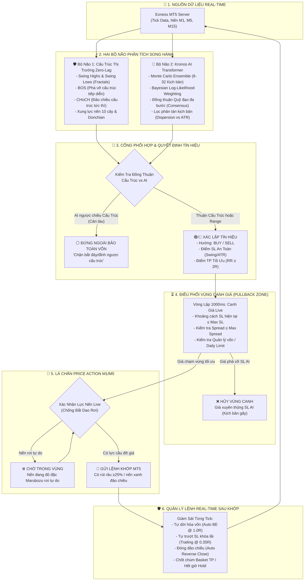

# 🏛️ Sơ Đồ Nguyên Lý Hoạt Động Trading AI PRO (v1.3.5)
### *Hệ Thống Scalping Vàng & Quản Lý Lệnh Đa Tầng Bằng Trí Tuệ Nhân Tạo Kronos*

---

## 1. Sơ Đồ Tổng Quan Toàn Hệ Thống (High-Level Architecture)

---

## 2. Lưu Trình Hoạt Động Chi Tiết Từng Bước (Detailed Pipeline Flowchart)

```mermaid
flowchart TD
    START(["Bắt đầu chu kỳ nến mới (M5/M15)"]) --> FETCH["Tải chuỗi nến Đã Đóng & Nến Đang Chạy từ MT5"]
    
    FETCH --> CHECK_STRUCT["🔍 1. Quét Cấu Trúc Thị Trường Zero-Lag"]
    CHECK_STRUCT --> C1{"Giá đang phá thủng đáy<br/>(Bearish BOS) hoặc 7/10 nến đỏ?"}
    C1 -- Đúng --> SET_DOWN["Đánh dấu Cấu Trúc: GIẢM (-1)"]
    C1 -- Sai --> C2{"Giá đang phá đỉnh<br/>(Bullish BOS) hoặc 7/10 nến xanh?"}
    C2 -- Đúng --> SET_UP["Đánh dấu Cấu Trúc: TĂNG (+1)"]
    C2 -- Sai --> SET_RANGE["Đánh dấu Cấu Trúc: CÂN BẰNG / RANGE (0)"]
    
    SET_DOWN --> RUN_AI
    SET_UP --> RUN_AI
    SET_RANGE --> RUN_AI
    
    RUN_AI["🤖 2. Khởi chạy Mô hình Kronos AI Transformer<br/>- Sinh 8 - 32 kịch bản tương lai<br/>- Tính % Đồng thuận (Bull% / Bear%)<br/>- Tính độ phân tán (Dispersion vs ATR)"] --> CHECK_DISP{"Độ phân tán<br/>> Max Dispersion?"}
    
    CHECK_DISP -- Đúng --> WAIT_UNCERTAIN["⚪ BẤT ĐỊNH CAO -> ĐỨNG NGOÀI (Né bẫy tin tức)"]
    CHECK_DISP -- Sai --> CHECK_CONSENSUS{"Đồng thuận<br/>≥ Ngưỡng cài đặt (75%)?"}
    
    CHECK_CONSENSUS -- Sai --> WAIT_LOW_CONF["⚪ ĐỒNG THUẬN THẤP -> ĐỨNG NGOÀI"]
    CHECK_CONSENSUS -- Đúng --> FILTER_TREND{"🛡️ 3. Kiểm Tra Bộ Lọc Cấu Trúc Thị Trường"}
    
    FILTER_TREND -- "AI báo BUY nhưng Cấu Trúc GIẢM (-1)" --> BLOCK_BUY["🛡️ CHẶN BẮT ĐÁY NGƯỢC CẤU TRÚC<br/>(Không trễ nến, triệt tiêu bắt dao rơi)"]
    FILTER_TREND -- "AI báo SELL nhưng Cấu Trúc TĂNG (+1)" --> BLOCK_SELL["🛡️ CHẶN BẮT ĐỈNH NGƯỢC CẤU TRÚC<br/>(Không trễ nến, không cản tàu bay)"]
    
    FILTER_TREND -- "Thuận Cấu Trúc hoặc Thị trường Range (0)" --> CALC_SLTP["📐 4. Xác Định Vùng Giá Entry, SL, TP<br/>- SL theo Swing Low/High + Buffer<br/>- Ép Max SL Price nếu vượt trần<br/>- Tối ưu tỷ lệ R:R ≥ 2.0R"]
    
    CALC_SLTP --> ZONE_CHECK["🎯 5. Kích Hoạt Vùng Canh Giá (Zone Watch)"]
    ZONE_CHECK --> LOOP_TICK["Theo dõi từng Tick / Giây:"]
    
    LOOP_TICK --> COND_SL{"Giá có phá qua SL của AI?"}
    COND_SL -- Đúng --> CANCEL_ZONE["❌ HỦY VÙNG CANH<br/>Kịch bản gãy -> Bảo toàn vốn 100%"]
    COND_SL -- Sai --> COND_TOUCH{"Khoảng cách SL hiện tại<br/>≤ Max SL cài đặt?"}
    
    COND_TOUCH -- Chưa tới --> LOOP_TICK
    COND_TOUCH -- Đã vào vùng --> PA_CHECK{"🔬 6. Lá Chắn Price Action (M1/M5)"}
    
    PA_CHECK -- "Nến đang cắm đầu đỏ đặc<br/>(Marubozu rơi tự do, chưa có lực đỡ)" --> WAIT_PA["⏸️ CHỜ: Giữ vùng canh, không vội bắt nến rơi"]
    WAIT_PA --> LOOP_TICK
    
    PA_CHECK -- "Xuất hiện lực đỡ:<br/>- Rút râu dưới ≥ 25%<br/>- Nến xanh đảo chiều<br/>- Bật nảy từ đáy ≥ 0.30$" --> SEND_ORDER["🚀 7. KHỚP LỆNH MT5 AN TOÀN<br/>Vào lệnh đúng đáy cây nến rút chân"]
    
    SEND_ORDER --> MANAGE["🛡️ 8. Quản Lý Vị Thế Sau Khớp (Real-Time Engine)"]
    
    MANAGE --> BE_CHECK{"Lãi ≥ 1.0R?"}
    BE_CHECK -- Đúng --> MOVE_BE["🔒 Tự kéo SL về Entry (Risk-Free)"]
    BE_CHECK -- Sai --> TRAIL_CHECK
    
    MOVE_BE --> TRAIL_CHECK{"Bật Trailing Stop &<br/>Giá tiếp tục chạy sâu?"}
    TRAIL_CHECK -- Đúng --> MOVE_TRAIL["📈 Trượt SL bám sát giá (0.35R) khóa lợi nhuận"]
    TRAIL_CHECK -- Sai --> REV_CHECK
    
    MOVE_TRAIL --> REV_CHECK{"Có tín hiệu AI đảo chiều mạnh?"}
    REV_CHECK -- Đúng --> CLOSE_REV["🔄 Đóng lệnh chủ động bảo toàn lãi/hòa vốn"]
    REV_CHECK -- Sai --> BASKET_CHECK{"Đạt Basket TP hoặc Chạm SL/TP sàn?"}
    
    BASKET_CHECK -- Đúng --> CLOSE_DONE["💰 Kết thúc chu kỳ lệnh an toàn"]
    BASKET_CHECK -- Sai --> MANAGE
```

---

## 3. Bảng Chi Tiết Các Khối Chức Năng Cốt Lõi

| Khối Chức Năng | Thành Phần Kỹ Thuật | Nhiệm Vụ & Cơ Chế Hoạt Động | Ưu Điểm Đột Phá (v1.3.5) |
| :--- | :--- | :--- | :--- |
| **1. Cấu Trúc Zero-Lag** | `Swing Highs / Lows`, `BOS`, `CHoCH` | Quét đỉnh/đáy fractal thực tế trên M5/M1 và M15. Khi giá đâm thủng đáy gần nhất $\rightarrow$ xác lập ngay pha Giảm. | **Không trễ nến (Zero Indicator Lag)**: Loại bỏ hoàn toàn độ trễ hàng chục nến của MA. |
| **2. AI Transformer** | `Kronos Time-Series Ensemble` | Dự phóng 8 - 32 đường đi ngẫu nhiên của nến tương lai, tính xác suất phân bổ và độ hội tụ. | Đo lường độ đồng thuận định lượng thay vì dựa vào 1 chỉ báo cảm tính. |
| **3. Cổng Phối Hợp** | `Multi-Layer Decision Gate` | Đối chiếu tín hiệu AI với Cấu Trúc Thực Tế. Nếu AI gợi ý BUY mà cấu trúc đang rơi tự do $\rightarrow$ **Phủ quyết, cấm mở lệnh**. | Chấm dứt tình trạng "bắt đáy cản tàu" khi thị trường sập giá sâu. |
| **4. Vùng Canh Giá** | `Pullback Zone Engine` | Không mua đuổi khi giá ở đỉnh. Chờ giá hồi về vùng có tỷ lệ $R:R \ge 2.0R$ và khoảng cách $SL \le Max\_SL$. | Luôn có vị thế vào lệnh tối ưu nhất, không bị đu đỉnh / bán đáy. |
| **5. Lá Chắn Price Action** | `Rejection & Absorption Shield` | Soi nến live trên M1/M5. Nến đỏ đặc rơi tự do $\rightarrow$ đứng yên chờ đợi. Chỉ vào khi nến rút râu hoặc bật nảy. | **Chống bắt dao rơi**: Bắt trúng điểm uốn của nhịp đảo chiều thay vì hứng trọn thân nến đỏ. |
| **6. Quản Lý Vị Thế** | `Auto BE`, `Trailing`, `Basket TP` | Tự động dời SL về hòa khi lãi $1.0R$, tự động trượt khóa lãi theo xu hướng, chốt chùm theo mục tiêu USD. | Biến lệnh có lãi thành lệnh "không thể thua", bảo toàn lợi nhuận tối đa. |

---

## 4. Các Quy Tắc Bảo Vệ Vốn "Bất Khả Xâm Phạm" (Zero-Loss Guardrails)

> [!IMPORTANT]
> **Quy Tắc 1 — Không Cản Tàu (Zero-Lag Trend Alignment)**:
> Khi Cấu trúc thị trường đang trong pha đổ đèo (Bearish BOS), bot **tuyệt đối từ chối mọi lệnh BUY**, bất kể AI dự báo kịch bản nảy hồi đẹp đến đâu.

> [!CAUTION]
> **Quy Tắc 2 — Chống Bắt Dao Rơi (Price Action Absorption)**:
> Giá chạm vào Vùng Canh Giá không đồng nghĩa với việc khớp lệnh ngay. Cây nến đang rơi tự do phải thể hiện rõ **lực cầu hấp thụ** (rút râu dưới $\ge 25\%$ biên độ hoặc có nến xanh đảo chiều) thì lệnh mới được kích hoạt.

> [!TIP]
> **Quy Tắc 3 — Kịch Bản Gãy Hủy Lệnh Ngay (Strict Invalidation)**:
> Nếu giá rơi xuyên thủng qua mức Cắt Lỗ (SL) đề xuất của mô hình AI trước khi kịp có tín hiệu Price Action $\rightarrow$ Vùng canh giá lập tức bị hủy bỏ, bảo toàn vốn $100\%$, không mất một xu phí nào.
